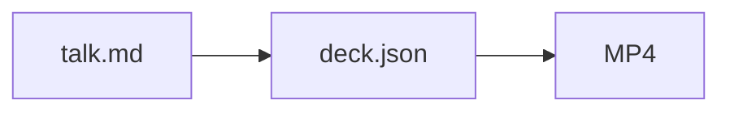

# Narrated decks

Write one Markdown file, run one command, get slides with a voice and captions. The theme, voice, timing and
caption style are fixed: do not restyle or tune them. Spend your effort on what the deck says.

## 1. Write the deck

Read the source document, pick the 4–8 points a newcomer needs, and write `<name>.md` next to where the user wants
the result. Every `#` or `##` heading starts a slide; the `> ` lines under it are spoken, one caption each.

```markdown
---
voice: af_heart
speed: 1.1
---

# Nightly backups

What runs every night, and how to get a file back.

> Every night, the server copies your files somewhere safe.
> Here is what it keeps, and how to restore one.

## How it works

1. At 2 AM a snapshot of `/data` is taken
2. Only changed blocks are uploaded
3. A check reads every snapshot back

> At two in the morning, it takes a snapshot of the data folder.
> Only the parts that changed are uploaded.
> Then it reads the snapshot back, to prove it is complete.

## What it keeps

- **30 days** of nightly snapshots
- **12 months** of monthly ones

> You can go back to any night in the last thirty days.
> After that, one snapshot per month is kept for a year.
```

Rules that keep it watchable:

- **Slides carry key words; narration carries sentences.** At most 5 bullets or a 4-row table per slide. A list
  whose every item starts with a bold number (`- **30 days** of snapshots`) becomes stat tiles; use them for 2–4
  key figures, never for bold labels.
- **One idea per spoken line**, at most 90 characters; aim for 2–4 lines per slide and 1–2 minutes in all.
- **Write narration the way it is said.** Spell out symbols and units the voice would misread ("150 MB" →
  "a hundred and fifty megabytes", "v2" → "version two"); plain numbers are fine.
- Images: `` with a path relative to the deck file. Tables render as they are.
- Front matter is optional; `af_heart` at `1.1` is the default English voice.

### Diagrams, code and step-by-step slides

- **Diagrams and charts:** a ` ```mermaid ` block becomes a diagram in the deck's colours: `flowchart LR` for a
  pipeline or a few boxes, `flowchart TD` with `subgraph`s for anything with layers, `sequenceDiagram` for who calls
  whom, `pie` and `xychart-beta` (`bar [...]`) for 2–6 numbers. Keep labels to a few words and at most about 8
  boxes; split a bigger system over two slides. Add `:::accent` to the one box the narration is about
  (`deck[deck.json]:::accent`). Never set colours or styles. A syntax error stops the build and names the slide.
- **Code:** tag every code block with its language (` ```python `, ` ```ts `, ` ```console `) so it is
  highlighted. Show a change as a ` ```diff ` block of a few lines. Mark the line the narration talks about with
  ` ```python hl_lines="3" `. At most about 8 lines per slide.
- **Step by step:** each `> ` line shows the slide as written above it. Put narration between body lines to build a
  slide while it is spoken: a list item by item, or a diagram after its introduction. Everything stays where it
  will be on the finished slide. Narration written after the whole body shows the whole slide from the start.

````markdown
## How a build runs

- Chrome draws every slide

> First, Chrome draws the slides.

- Each line is voiced

> Then every spoken line is voiced.



> Both meet in one deck, and an MP4 when you ask.
````

### Layout: boxes, then HTML

Plain Markdown stacks top to bottom. For columns, cards or a full-frame picture, put Markdown in a **box**: a
`::: class …` line opens one, a line of only `:::` closes it (Pandoc's fenced divs). Boxes nest; the words after
`:::` are classes from this list. The class names and theme variables are Sideshow's, so they read the same as in an
html surface there.

- **Layout:** `row` lays its boxes side by side, with `grow` on each box that shares the width; `stack` is a
  column with gaps, `between` pushes two things to the ends. `sm` and `lg` tighten or widen a `row` or `stack`.
- **Look:** `card` frames its content, `card soft` fills it, `card accent` marks the one the narration is about;
  `title` (a card's heading, `<p class="title">`), `dim`, `faint`, `mono`, `num`.
- **Full frame:** `bleed` around one image fills the slide edge to edge above the caption band, covering its heading.
- **Inline, in HTML:** `<span class="badge">` with `ok`, `info`, `warn` or `danger`; `chip`, `dot`, `kbd`;
  `<div class="bar"><i style="width: 60%"></i></div>`; `<ul class="tree">` for a nested status list.

````markdown
## Parallel or Exa

::: row
::: grow card soft
<p class="title">Parallel</p>

- On today

> Today, searches go through Parallel.

:::
::: grow card accent
<p class="title">Exa</p>

- Off by default
:::
:::

> Exa offers the same tools, off until you turn it on.
````

A spoken line inside a box builds the slide across columns: here the left card shows first, already where it ends up,
then the right one appears beside it.

When boxes cannot say it, write HTML or SVG in the deck, but keep it on the theme:

- Use the classes above before writing any CSS, and never a `<style>` block. Colours and sizes come from the theme's
  variables: `var(--color-text-primary|secondary|tertiary|info|success|warning|danger)`, the same set as
  `--color-background-*` and `--color-border-*` (`info` is the accent), `var(--color-text-heading)`,
  `var(--font-sans|mono)`, `var(--font-size-body|small|title)`, `var(--border-radius-md|lg|xl)`. Never a colour
  code.
- For a drawing: `<svg width="100%" viewBox="0 0 1680 420">` (one unit is about one pixel), with `class="t"`,
  `ts` (small, muted) and `th` (bold) on text, `box` on rects, `arr` and `leader` on lines,
  `marker-end="url(#arrow)"` for an arrowhead, and `c-blue`, `c-teal`, `c-amber`, `c-coral`, `c-green`, `c-red` or
  `c-gray` on a shape or `<g>` to colour it and its text.
- Keep it in normal flow: no `position: fixed` or `absolute`; to overlap, put both in one grid cell
  (`display: grid`, `grid-area: 1 / 1`).
- Nothing external: no URLs, web fonts, CDNs or scripts. Builds are offline and every frame is a still picture;
  images are files next to the deck.
- Flat: no gradients, shadows or emoji; sentence case.

After any box or HTML, check `contact.jpg` (below): columns that wrap or text that overflows show there first.

## 2. Build and preview

```bash
python /absolute/path/to/narrated-demo/scripts/deck.py /absolute/path/to/<name>.md
```

It writes `<name>.deck/` beside the source: `deck.json` (the player manifest, with each line's text and start),
`narration.m4a`, one frame per slide and step, `contact.jpg` (every finished slide) and `<name>.srt`. The first deck
with a diagram downloads Mermaid once (3.5 MB, see [setup](references/setup.md)); after that it builds offline. Captions are text, never drawn
into the slides: the player shows them, and the bottom fifth of every slide stays empty for them. Lines and frames are
cached, so a re-run after an edit re-voices and redraws only what changed; it takes seconds. A problem (a line too long, a slide without
narration) stops it with a message naming the slide.

Check `contact.jpg` once: text fits, nothing is cut off, every slide says something. Fix the Markdown and re-run;
never edit the generated files. `<name>.deck/` is build output: do not commit or format it unless the user asks.

## 3. Deliver

- **In Ultimate:** link the deck's `deck.json` by its absolute path, `[My deck](/abs/path/<name>.deck/deck.json)`.
  The transcript shows it as a slide player with audio, captions (CC to hide them), slide skipping and YouTube's
  keys (Space, ←/→, F, C).
- **Anywhere else, or when the user asks for a video:** add `--video` to write `<name>.deck/<name>.mp4`, and report
  its path. The captions are a subtitle track players can turn on and off, not pixels.

Report the deck path, its duration (printed by the build), and anything you left out of the source document.

## Screen recordings

To narrate a recording of a real web UI in motion (a bug, a feature walkthrough), follow
[screen-demo](references/screen-demo.md) instead.
