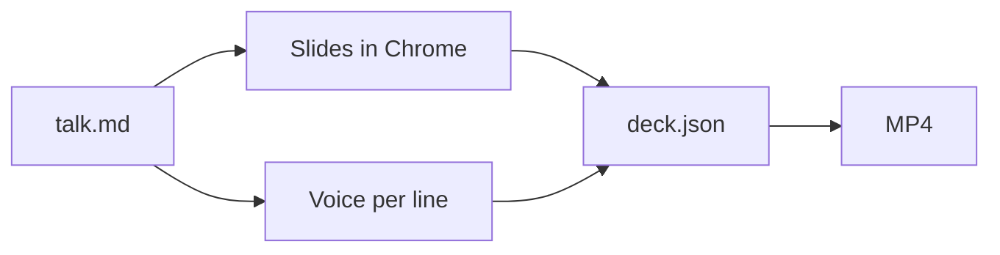

# Narrated decks

Turn a document into a short spoken explainer.

> This is a narrated deck: slides with a voice and subtitles.
> It takes a document and explains it in about a minute.

## One file, one command

1. Write `talk.md`: a heading per slide

> You write one Markdown file, and every heading starts a slide.

2. Add the spoken lines under each slide

> The quoted lines are spoken, and each one shows the slide as written above it.

3. Run `deck.py talk.md`

> Then one command draws the slides and records the voice.

## How a build runs



> Chrome draws the slides, diagrams included, while each line is voiced.
> Both come together in one deck, and an MP4 when you ask for it.

## Code reads as code

```diff
  def total(items):
-     return sum(items)
+     return sum(item.price for item in items)
```

> Code blocks are highlighted, and diffs show what was added and removed.

## What you get

- **1 card** to play it in the transcript
- **0 s** to re-render unchanged lines
- **1 flag** to export an MP4

> The result plays as a card, right where you are working.
> Edit one line and only that line is voiced again.
> When you need a file to share, add the video flag.

## Keep slides short

| On the slide | In the narration |
| --- | --- |
| Key words and numbers | Full sentences |
| Five bullets at most | One idea per line |

> Put key words and numbers on the slide.
> Say the full sentence in the narration.
